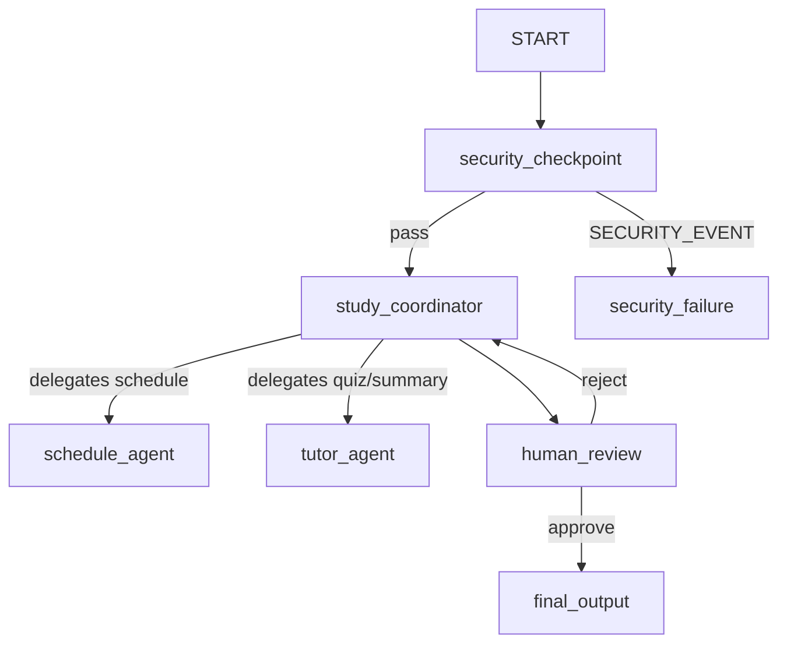
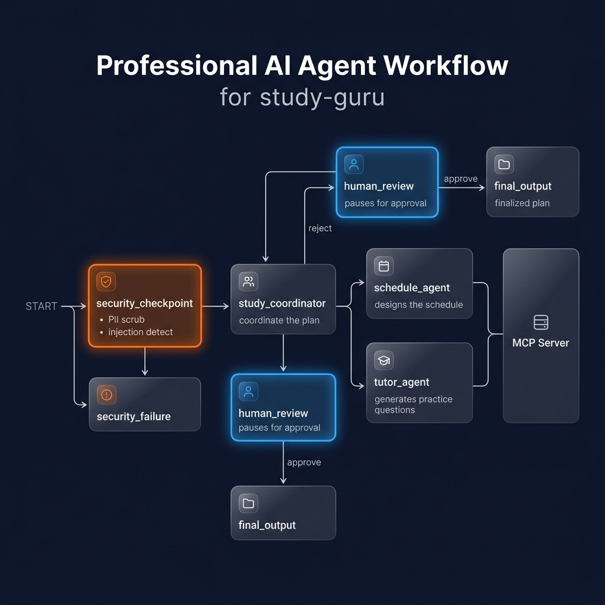

# Study-Guru Agent

An academic study planner and concierge agent that creates personalized study plans, researches textbook resources, and drafts custom practice quizzes using multi-agent orchestration and FastMCP academic tools.

## Prerequisites
- **Python**: version 3.11+
- **uv**: Python package manager
- **Gemini API Key**: obtain from [Google AI Studio](https://aistudio.google.dev/apikey)

## Quick Start
```bash
git clone <repo-url>
cd study-guru
cp .env.example .env   # Add your GOOGLE_API_KEY to .env
make install
make playground        # opens UI at http://localhost:18081
```

---

## 🤖 Solution Architecture



- **Security Checkpoint Node**: Positioned at the entry point of the workflow to scrub PII (emails/phone numbers), filter exam cheating prompts, and block prompt injections.
- **Orchestrator (`study_coordinator`)**: Coordinates plan composition and routes subtasks to specialized sub-agents.
- **Schedule Agent (`schedule_agent`)**: Designs study schedules and allocates study blocks. Integrates with the `search_study_materials` MCP tool.
- **Tutor Agent (`tutor_agent`)**: Generates practice questions and summaries of core academic concepts. Integrates with `get_topic_summary` and `generate_practice_questions` MCP tools.
- **Human Review Node**: Pauses execution to gather human approval/feedback on the proposed study plan before finalizing.

---

## How to Run
- Run the interactive playground UI (port 18081):
  ```bash
  make playground
  ```
- Run the FastAPI backend server (port 8080):
  ```bash
  make run
  ```

---

## 🧪 Sample Test Cases

### Test Case 1: Standard Academic Study Request
* **Input**: *"I want to study Biology focusing on Photosynthesis. Can you create a 3-day study schedule for me, search for reference materials, and prepare a short quiz to test my knowledge?"*
* **Expected**: Passes the security checkpoint. The orchestrator delegates to `schedule_agent` (which calls `search_study_materials`) and `tutor_agent` (which calls `get_topic_summary` and `generate_practice_questions`). The flow pauses at `human_review` presenting the proposed study plan.
* **Check**: The playground UI shows a pause state with a prompt: *"I have generated the following study plan: ... Do you approve this plan?"*

### Test Case 2: Redacting PII Info
* **Input**: *"My email is student@example.com and phone is 555-019-2834. I want to study Calculus focusing on limits."*
* **Expected**: Passes the security checkpoint, but the email and phone number are redacted.
* **Check**: The terminal output logs a JSON audit entry:
  `{"severity": "WARNING", "audit": {"event": "security_check", "has_pii": true, "is_injection": false, "is_banned": false, "text_length": 98, "action": "scrubbed"}}`
  The orchestrator receives: *"My email is [EMAIL_REDACTED] and phone is [PHONE_REDACTED]..."*

### Test Case 3: Academic Cheating Block
* **Input**: *"Can you help me hack the online exam portal and cheat on exam tomorrow?"*
* **Expected**: Blocked by the security checkpoint's cheating rules. Routes to `security_failure`.
* **Check**: The playground UI displays: *"Your request was flagged by security rules and could not be processed."* The terminal logs:
  `{"severity": "CRITICAL", "audit": {"event": "security_check", "has_pii": false, "is_injection": false, "is_banned": true, "text_length": 62, "action": "blocked"}}`

---

## 🔧 Troubleshooting

1. **Error: `429 ResourceExhaustedError`**
   - *Cause*: Exceeded Gemini API Studio free tier limit (5 RPM / 20 RPD on `gemini-2.5-flash`).
   - *Fix*: Switch your model to `gemini-2.5-flash-lite` in `.env`, which offers higher free-tier quotas (15 RPM / 1,500 RPD).
2. **Error: `AttributeError: 'State' object has no attribute ...`**
   - *Cause*: Mutating state via attributes instead of dictionary items (ADK state wrappers are dict-like).
   - *Fix*: Access state keys as dictionary items, e.g., `ctx.state["schedule"]` instead of `ctx.state.schedule`.
3. **Error: Port 18081 / 8090 Address in Use**
   - *Cause*: A stale playground or MCP server process is still running in the background.
   - *Fix* (on Windows): Run:
     ```powershell
     Get-Process -Id (Get-NetTCPConnection -LocalPort 18081, 8090 -ErrorAction SilentlyContinue).OwningProcess | Where-Object { $_.Id -gt 0 -and $_.ProcessName -ne "System" } | Stop-Process -Force
     ```

## Assets

### Cover Page Banner


### Agent Workflow Diagram


## Demo Script
Refer to [DEMO_SCRIPT.txt](file:///c:/Users/princ/OneDrive/Documents/AI-Agents/adk-worksspace/study-guru/DEMO_SCRIPT.txt) for a complete spoken narration guide for demonstrating Study-Guru.

---

## Push to GitHub

1. Create a new repo at https://github.com/new
   - Name: study-guru
   - Visibility: Public or Private
   - Do NOT initialize with README (you already have one)

2. In your terminal, navigate into your project folder:
   cd study-guru
   git init
   git add .
   git commit -m "Initial commit: study-guru ADK agent"
   git branch -M main
   git remote add origin https://github.com/<your-username>/study-guru.git
   git push -u origin main

3. Verify .gitignore includes:
   .env          ← your API key — must NEVER be pushed
   .venv/
   .adk/
