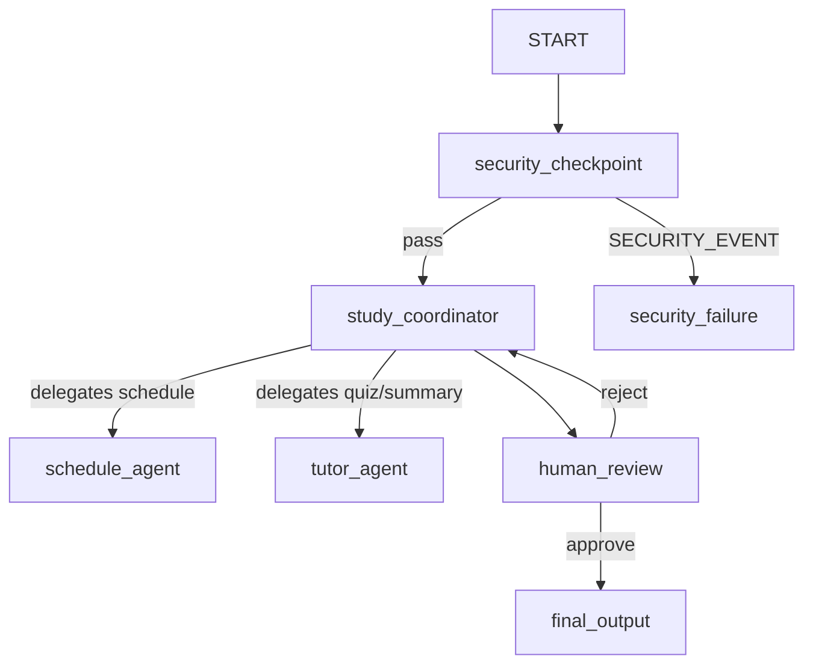

# Submission Write-Up: Study-Guru

## 1. Problem Statement
Students and academics often struggle to organize their study routines when encountering new, complex subjects. Generic calendar tools do not understand the conceptual progression of academic topics, nor do they provide relevant study resources or practice materials. Study-Guru solves this by acting as an academic concierge that creates customized study schedules, retrieves targeted reading/course materials, and prepares quizzes to test comprehension.

---

## 2. Solution Architecture

---

## 3. Concepts Used

This agent is built using the following core components of the **Google Agent Development Kit (ADK) 2.0**:

* **ADK Workflow & Graph routing**: Implemented in [`app/agent.py`](file:///c:/Users/princ/OneDrive/Documents/AI-Agents/adk-worksspace/study-guru/app/agent.py#L208-L222) via `Workflow` and `Edge` to declare routing logic (including loops back to the coordinator on revision).
* **LlmAgent**: Used for specialized sub-agents `schedule_agent` and `tutor_agent` in [`app/agent.py`](file:///c:/Users/princ/OneDrive/Documents/AI-Agents/adk-worksspace/study-guru/app/agent.py#L59-L88).
* **AgentTool**: Used in [`app/agent.py`](file:///c:/Users/princ/OneDrive/Documents/AI-Agents/adk-worksspace/study-guru/app/agent.py#L82-L88) to map sub-agents as tools for the orchestrator, enabling hierarchy.
* **MCP Server Integration**: Implemented in [`app/mcp_server.py`](file:///c:/Users/princ/OneDrive/Documents/AI-Agents/adk-worksspace/study-guru/app/mcp_server.py) using FastMCP. Wired in [`app/agent.py`](file:///c:/Users/princ/OneDrive/Documents/AI-Agents/adk-worksspace/study-guru/app/agent.py#L52-L57) using `McpToolset` and `StdioConnectionParams`.
* **Security Checkpoint Node**: Positioned at the entry point in [`app/agent.py`](file:///c:/Users/princ/OneDrive/Documents/AI-Agents/adk-worksspace/study-guru/app/agent.py#L107-L167) to enforce safety policies.
* **Agents CLI**: Used for local validation, playground hosting (`adk web`), and test running (`adk run`).

---

## 4. Security Design

To prevent academic plagiarism, data leaks, and system manipulation, three key security controls are implemented inside the `security_checkpoint` node:

* **PII Redaction**: Email and phone patterns are scrubbed from user input to protect student privacy.
* **Prompt Injection Detection**: Blocks standard injection instructions to avoid system prompt leakage or model hijack.
* **Cheating Content Filter**: Implements domain-specific bans on exam cheating keywords (e.g. `hack`, `cheat on exam`), promoting academic integrity.
* **Structured Auditing**: Every query outputs a JSON log (with severity fields: `INFO`, `WARNING`, `CRITICAL`) which registers a permanent record of input safety.

---

## 5. MCP Server Design

The FastMCP server exposes three academic search and generation tools:

1. **`search_study_materials(subject: str)`**: Queries textbook repositories and course directories to list recommended reading. Used by `schedule_agent` to build study resources.
2. **`get_topic_summary(topic: str)`**: Retrieves detailed summaries of core academic concepts. Used by `tutor_agent` for lesson planning.
3. **`generate_practice_questions(topic: str, num_questions: int)`**: Generates sample exam questions for self-assessment. Used by `tutor_agent` to draft custom quizzes.

---

## 6. Human-in-the-Loop (HITL) Flow

A `human_review` node interrupts the workflow using `RequestInput`. 
- **Purpose**: Academic planning is highly personal. Rather than generating plans blindly, the agent presents a draft schedule to the student.
- **Loop Logic**: If the user responds with `"yes"`, the workflow moves to `final_output`. If the user rejects or provides feedback, the orchestrator receives the feedback and refines the schedule, creating a feedback loop.

---

## 7. Demo Walkthrough

The agent handles diverse scenarios:
1. **Regular Request**: A student asks for a Photosynthesis study plan. The orchestrator routes subtasks to the schedule and tutor agents, retrieves materials via MCP, and shows the draft in the playground UI waiting for user approval.
2. **PII Redaction**: A student inputs contact information. The security node scrubs it, logs a `WARNING`, and propagates a clean query.
3. **Malicious Cheating Query**: A student asks the agent to help bypass an online exam. The security node intercepts this, logs a `CRITICAL` audit entry, and routes the student directly to a rejection notice.

---

## 8. Impact / Value Statement

Study-Guru empowers students to take control of their learning by turning generic research requests into active, actionable study schedules. It saves time by curating textbooks and creating custom quizzes instantly, while its built-in security checkpoints ensure that the concierge remains a safe, academic-friendly study tool.
